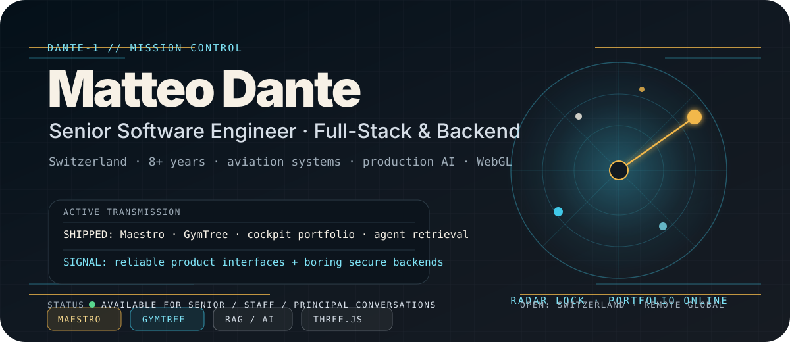
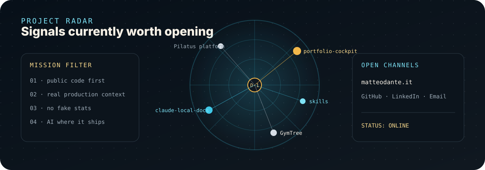
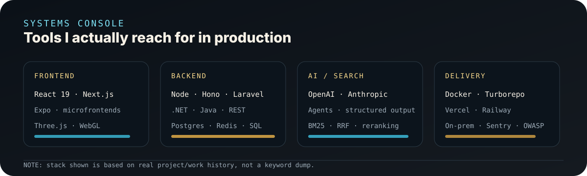

# DANTE-1 Mission Control

<p align="center">
  <a href="https://matteodante.it" aria-label="Open Matteo Dante portfolio">
    
  </a>
</p>

<p align="center">
  <a href="https://matteodante.it"></a>
  <a href="https://github.com/matteodante/portfolio-cockpit"></a>
  <a href="https://linkedin.com/in/matteo-dante-3705b5164"></a>
</p>

```text
BLACK BOX / DANTE-1

I build production systems where product interfaces, backend constraints,
data retrieval, security, and AI-assisted workflows all meet.

Current orbit: Switzerland · Senior Software Engineer · Full-Stack & Backend
Primary sectors: aviation · consumer traffic · retail operations · AI products
```

## Flight plan

I'm **Matteo Dante** — a senior software engineer based in **Switzerland** with **8+ years** across aviation, high-traffic consumer platforms, CRM / sales analytics, retail operations, and solo-built App Store products.

I like systems that have to work outside the demo: restricted enterprise environments, real users, paid subscriptions, search quality problems, observability, security, and UI surfaces that people actually operate every day.

- **At Pilatus Aircraft:** one of the principal engineers on a greenfield pilot-training platform shipped on-premise into enterprise customer environments.
- **Shipped GymTree:** full-stack fitness app live on the App Store — coach web, trainee mobile app, background workers, subscriptions, and production AI for coach chat + personalized plans. [Open App Store](https://apps.apple.com/us/app/gymtree-workout-ai-coach/id6761392403?uo=4)
- **Shipped Maestro:** native iOS AI tutor live on the App Store — source-grounded courses, lessons, quizzes, review, and tutor chat. [Open App Store](https://apps.apple.com/us/app/maestro-learn-anything/id6780267046?uo=4)
- **Open-source signal:** [`claude-local-docs`](https://github.com/matteodante/claude-local-docs), a Claude Code plugin for local-first documentation retrieval with hybrid search and reranking.
- **This profile's visual language:** lifted from [`portfolio-cockpit`](https://github.com/matteodante/portfolio-cockpit), my 3D portfolio where you fly between planets instead of scrolling sections.

<p align="center">
  
</p>

## Mission sectors

### `01` Aviation platform engineering
Greenfield pilot-training platform aggregating simulator, quiz, and lesson-system data. Enterprise on-premise delivery, regulated quality process, waterfall delivery model, microfrontend architecture, frontend design system ownership, reviews, hiring interviews, and onboarding.

### `02` Consumer-scale backend systems
Backend microservices for a high-traffic consumer directory platform with subscription advertisers, millions of pageviews per day, **2M+ registered users**, and **10k+ peak concurrent** traffic.

### `03` AI products and retrieval systems
LLM agents, streaming responses, structured outputs, persistent AI chat, embeddings, BM25, Reciprocal Rank Fusion, and cross-encoder reranking — used for real product flows, not just demos.

### `04` Solo App Store product shipping
**Maestro** is a native iOS AI tutor on the App Store. **GymTree** is a fitness app live on the App Store. Both are end-to-end product work: app UX, backend/API, subscriptions, observability, store presence, and production AI flows.

- Maestro: https://apps.apple.com/us/app/maestro-learn-anything/id6780267046?uo=4
- GymTree: https://apps.apple.com/us/app/gymtree-workout-ai-coach/id6761392403?uo=4

<p align="center">
  
</p>

## Public coordinates

| Signal | Open it when you want to see... |
| --- | --- |
| [Maestro: Learn Anything](https://apps.apple.com/us/app/maestro-learn-anything/id6780267046?uo=4) | native iOS AI tutor on the App Store: source-grounded lessons, quizzes, review, and tutor chat |
| [GymTree: Workout & AI Coach](https://apps.apple.com/us/app/gymtree-workout-ai-coach/id6761392403?uo=4) | App Store fitness app: workouts, diet, progress, subscriptions, and AI coach |
| [`portfolio-cockpit`](https://github.com/matteodante/portfolio-cockpit) | the 3D cockpit portfolio, gated CV architecture, streaming AI assistant, EN/IT i18n |
| [`claude-local-docs`](https://github.com/matteodante/claude-local-docs) | local-first documentation search for coding agents: vector + BM25 + RRF + reranking |
| [`skills`](https://github.com/matteodante/skills) | reusable agent skills and operational playbooks |
| [`matteodante.it`](https://matteodante.it) | the live portfolio, AI assistant, and public CV summary |

## Operating principles

```text
┌─ HOW I LIKE TO SHIP ───────────────────────────────────────────────┐
│ 01. Product UI should feel intentional, not generated.             │
│ 02. Backends should be observable, secure, and boring under load.   │
│ 03. AI belongs where it removes real workflow friction.             │
│ 04. Retrieval quality beats prompt theater.                         │
│ 05. A side project is not done until it survives production shape.  │
└────────────────────────────────────────────────────────────────────┘
```

<details>
<summary><strong>Mission log</strong></summary>

- **2024 → now · Pilatus Aircraft** — senior full-stack software engineer, mainly frontend, pilot-training platform, on-premise enterprise delivery.
- **2023 → 2024 · DonTouch SA** — backend engineer, high-traffic consumer platform, advertiser mobile backend, transactional queries, Redis / SQL Server.
- **2019 → 2023 · Hexa Credit Care** — full-stack developer, multi-tenant CRM, real-time reporting, call-center analytics.
- **2018 → 2019 · Galileo SpA** — full-stack developer, retail catalog / media / logistics, AS/400 integration, 40k+ SKUs.
- **2026 → now · Maestro** — native iOS AI tutor on the App Store: https://apps.apple.com/us/app/maestro-learn-anything/id6780267046?uo=4
- **2025 → now · GymTree** — solo-built fitness platform with production AI flows, live on the App Store: https://apps.apple.com/us/app/gymtree-workout-ai-coach/id6761392403?uo=4

</details>

## Open channel

- **Portfolio / AI assistant:** [matteodante.it](https://matteodante.it)
- **LinkedIn:** [linkedin.com/in/matteo-dante](https://linkedin.com/in/matteo-dante-3705b5164)
- **Email:** [matteo.dante659@gmail.com](mailto:matteo.dante659@gmail.com)
