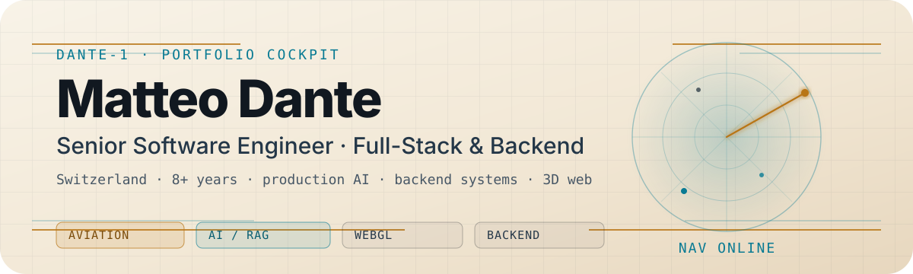

<p align="center">
  <a href="https://matteodante.it" aria-label="Open Matteo Dante portfolio">
    <picture>
      <source media="(prefers-color-scheme: dark)" srcset="./assets/header-dark.svg">
      <source media="(prefers-color-scheme: light)" srcset="./assets/header-light.svg">
      
    </picture>
  </a>
</p>

<p align="center">
  <a href="https://matteodante.it"></a>
  <a href="https://linkedin.com/in/matteo-dante-3705b5164"></a>
  <a href="mailto:matteo.dante659@gmail.com"></a>
  <a href="https://github.com/matteodante?tab=repositories"></a>
</p>

## Mission control

I'm **Matteo Dante**, a **Senior Software Engineer** based in **Switzerland**.

I build production software across **aviation**, **high-traffic consumer platforms**, **retail**, and **AI-heavy products** — usually where frontend, backend, data, security, and delivery constraints all meet.

- **Now:** senior full-stack engineer at **Pilatus Aircraft**, working on a greenfield pilot-training platform shipped on-premise into enterprise customer environments.
- **Also building:** **GymTree**, a solo-built fitness platform with backend API, coach web console, trainee mobile app, background workers, subscriptions, and an AI coach.
- **Open source:** **claude-local-docs**, a local-first Claude Code docs indexer with vector search, BM25, RRF, and cross-encoder reranking.
- **Portfolio:** [matteodante.it](https://matteodante.it), a 3D cockpit you fly through instead of scroll.

## Systems I like to build

| Area | What I reach for |
| --- | --- |
| **Frontend / platform** | React 19, Next.js App Router, React Native / Expo, microfrontends, vanilla Three.js / WebGL |
| **Backend / data** | Node.js, Hono, Express, Laravel, PHP, .NET, Java, PostgreSQL, MySQL, SQL Server, Redis, Prisma, BullMQ |
| **AI / search** | OpenAI, Anthropic, LLM agents, structured outputs, streaming, embeddings, BM25, RRF, cross-encoder reranking |
| **Infra / quality** | Docker, Turborepo, Vercel, Railway, on-premise deployments, Vitest, Sentry, OWASP, OAuth/JWT |

## Selected work

### [portfolio-cockpit](https://github.com/matteodante/portfolio-cockpit)
Interactive 3D cockpit portfolio: fly between planets that open CV sections, with a streaming AI co-pilot. Built with **Next.js 16**, **React 19**, **vanilla Three.js**, **Tailwind v4**, and the **OpenAI Responses API**.

### [claude-local-docs](https://github.com/matteodante/claude-local-docs)
Open-source Claude Code plugin for local documentation retrieval. It combines **vector embeddings**, **BM25**, **Reciprocal Rank Fusion**, and **cross-encoder reranking** so coding agents can pull better context without leaving the machine.

### GymTree
Solo-built fitness platform currently in App Store review. Full-stack ownership across **backend API**, **coach web**, **trainee mobile app**, **marketing site**, and **background workers**. Production AI handles persistent coach chat and personalized workout / nutrition plan generation.

### [skills](https://github.com/matteodante/skills)
An open-source collection of agent skills: reusable operational playbooks for AI-assisted engineering workflows.

## Production contexts I've worked in

- **Aviation:** greenfield pilot-training platform, regulated quality process, on-premise enterprise deployments, microfrontend delivery.
- **Consumer traffic:** backend microservices for a directory platform with subscription advertisers, millions of pageviews per day, 2M+ registered users, 10k+ peak concurrent.
- **CRM / sales analytics:** multi-tenant platform for 300 call-center operators, client-specific configuration and real-time dashboards.
- **Retail operations:** catalog, media, logistics, AS/400 integration, B2B ordering, PDF / print pipelines, 40k+ SKUs.

## Current navigation

```text
DANTE-1 / ACTIVE ROUTE
├─ Ship reliable product interfaces
├─ Keep backend systems boring, observable, and secure
├─ Use AI where it actually improves the workflow
├─ Make retrieval systems less noisy and more useful
└─ Turn side projects into production-grade systems
```

## GitHub signal

Most of the public work worth opening first is TypeScript-heavy and product-facing:

- [`portfolio-cockpit`](https://github.com/matteodante/portfolio-cockpit) — 3D portfolio, AI co-pilot, gated CV, i18n.
- [`claude-local-docs`](https://github.com/matteodante/claude-local-docs) — local-first retrieval for coding agents.
- [`skills`](https://github.com/matteodante/skills) — reusable agent skills and operational playbooks.

## Contact

- Portfolio and AI assistant: **[matteodante.it](https://matteodante.it)**
- LinkedIn: **[linkedin.com/in/matteo-dante](https://linkedin.com/in/matteo-dante-3705b5164)**
- Email: **[matteo.dante659@gmail.com](mailto:matteo.dante659@gmail.com)**
